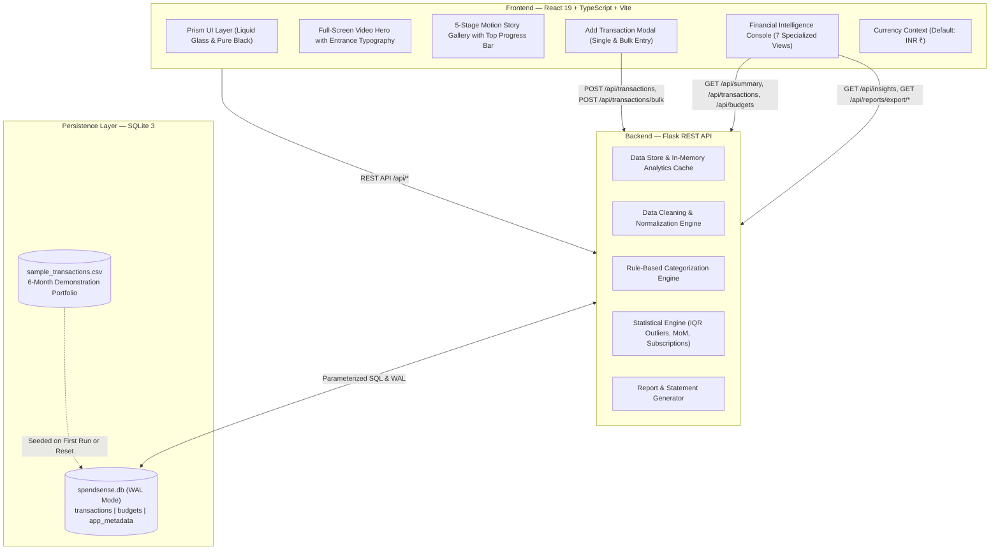

# SpendSense — Personal Finance Intelligence Platform

[](https://github.com/tharun-bytes/SpendSense)
[](https://www.python.org/)
[](https://palletsprojects.com/p/flask/)
[](https://www.sqlite.org/)
[](https://react.dev/)
[](https://www.typescriptlang.org/)
[](https://vitejs.dev/)
[](https://tailwindcss.com/)
[](https://motion.dev/)
[](https://docs.pytest.org/)

**SpendSense** is a full-stack personal finance intelligence console designed to ingest, clean, categorize, and persistently track financial transactions. It pairs an executive, dark-mode **Prism design system** with a persistent **SQLite database engine** and rigorous **data science analytics** (Interquartile Range statistical outlier detection, recurring subscription clustering, and real-time category budget monitoring).

Users can import arbitrary bank CSV statements, log single or bulk transactions manually through interactive modals, edit/delete entries on the fly, and download audit-ready financial statements.

---

## Table of Contents

- [Key Features](#key-features)
- [System Architecture](#system-architecture)
- [The Prism Design System & Motion Gallery](#the-prism-design-system--motion-gallery)
- [Database & Persistence Layer](#database--persistence-layer)
- [Statistical Formulas & Analytics](#statistical-formulas--analytics)
- [API Specification](#api-specification)
- [Project Structure](#project-structure)
- [Quick Start & Local Setup](#quick-start--local-setup)
- [Automated Testing Suite](#automated-testing-suite)
- [License & Authors](#license--authors)

---

## Key Features

- **Multi-Method Transaction Management**:
  - **CSV Statement Ingestion**: Handles messy banking exports, multi-format dates (`YYYY-MM-DD`, `DD/MM/YYYY`, `MM-DD-YYYY`, text months), deduplication, and credit/debit column mapping.
  - **Single Manual Add**: Modal for logging income/expenses with amount, date, category, payment method, and notes.
  - **Bulk Entry Interface**: Multi-row paste parser allowing users to log tens of transactions at once with automated row validation.
  - **In-Line Editing & Deletion**: Update or delete transactions directly from the interactive ledger with instantaneous recalculation.
  - **Empty State & Data Reset**: Clear ledger anytime or restore the 6-month demonstration portfolio with one click.
- **SQLite Database Persistence**:
  - Thread-safe SQLite persistence (`data/spendsense.db`) with Write-Ahead Logging (`WAL`), indexes on `date`, `category`, `type`, and `is_demo`, and ACID transaction protection.
- **Automated Categorization Engine**:
  - Deterministic rule engine assigning transactions across 11 personal finance sectors: **Housing, Food & Dining, Utilities, Transportation, Shopping, Subscriptions, Entertainment, Healthcare, Education, Travel, Income**, and **Other**.
- **Nonparametric IQR Anomaly Radar**:
  - Identifies irregular expense spikes using quartile distribution formulas ($Q_3 + 1.5 \times \text{IQR}$) rather than arbitrary static limits.
- **Recurring Liability & Subscription Detection**:
  - Clusters recurring debits (Netflix, Spotify, AWS, Rent) based on cross-month occurrence and coefficient of variation ($\le 10\%$).
- **Dynamic Category Budgeting**:
  - Real-time comparison of actual disbursements against monthly allowances with automated health thresholds (Healthy, Warning $\ge 80\%$, Exceeded $\ge 100\%$).
- **Multi-Currency Support**:
  - Native support for **INR (₹)** as default, with dynamic toggle for **USD ($)**, **EUR (€)**, and **GBP (£)**.
- **Audit-Compliant Statement Exports**:
  - One-click export of normalized CSV statements and executive summary financial reports.

---

## System Architecture



---

## The Prism Design System & Motion Gallery

### The Prism Aesthetic
- **Canvas & Contrast**: Pure black background (`#000000`) paired with luminous typography and emerald/rose indicators.
- **Liquid Glass**: Dual-tier `.liquid-glass` and `.liquid-glass-strong` cards with `backdrop-filter: blur(24px)` and fine masked gradient borders.
- **Refined Typography**: Display serif (**Instrument Serif** Italic), ergonomic UI text (**Barlow**), and financial data numerals (**Geist Mono**).

### Five-Stage Motion Story Gallery
Interactive walkthrough linking portfolio milestones to descriptive, meaningful labels:
1. **FINANCIAL OVERVIEW** — *See the Full Picture*: Velocity of cashflow and capital retention.
2. **SPENDING BREAKDOWN** — *Understand Your Spending*: Sector capital distribution across 11 categories.
3. **BUDGET HEALTH** — *Stay on Budget*: Allocation thresholds and active month caps.
4. **ANOMALY DETECTION** — *Discover Patterns*: Nonparametric IQR statistical outlier radar.
5. **ACTIONABLE INSIGHTS** — *Make Smarter Decisions*: Direct action buttons to launch the console or import statements.

*Includes a sleek, top-mounted 3px scroll indicator that smoothly tracks progression through the gallery and automatically fades to 0% opacity outside the active animation boundaries.*

---

## Database & Persistence Layer

All financial records and category allowances are persistently stored in SQLite (`data/spendsense.db`):

- **`transactions` table**:
  - `id` (`TEXT PRIMARY KEY`), `date` (`TEXT NOT NULL`), `description` (`TEXT NOT NULL`), `amount` (`REAL NOT NULL`), `category` (`TEXT NOT NULL`), `type` (`TEXT NOT NULL`), `payment_method` (`TEXT`), `notes` (`TEXT`), `is_demo` (`INTEGER`), `created_at` (`TEXT`), `updated_at` (`TEXT`).
  - Indexed on: `idx_transactions_date`, `idx_transactions_category`, `idx_transactions_type`, `idx_transactions_is_demo`.
- **`budgets` table**:
  - `category` (`TEXT PRIMARY KEY`), `monthly_limit` (`REAL NOT NULL`), `updated_at` (`TEXT`).
- **`app_metadata` table**:
  - Key-value metadata store tracking ingestion audit statistics, active dataset mode, and source filenames.

---

## Statistical Formulas & Analytics

SpendSense evaluates metrics deterministically from active records without artificial approximations:

### 1. Net Cash Flow & Savings Efficiency Rate
$$\text{Net Cash Flow} = \sum \text{Income} - \sum \text{Expenses}$$

$$\text{Savings Rate (\%)} = \left( \frac{\text{Net Cash Flow}}{\sum \text{Income}} \right) \times 100$$

### 2. Month-over-Month (MoM) Outflow Change
$$\text{MoM Change (\%)} = \left( \frac{\text{Expenses}_{\text{current}} - \text{Expenses}_{\text{previous}}}{\text{Expenses}_{\text{previous}}} \right) \times 100$$

### 3. Nonparametric Outlier Detection (Interquartile Range)
$$\text{IQR} = Q_3 (75\text{th percentile}) - Q_1 (25\text{th percentile})$$

$$\text{Outlier Upper Threshold} = Q_3 + 1.5 \times \text{IQR}$$

$$\Delta_{\text{deviation}} = \text{Amount} - Q_3$$

### 4. Recurring Subscription Detection
A transaction is flagged as a recurring subscription when:
1. The merchant or description matches across $\ge 2$ distinct calendar months.
2. The coefficient of variation $\frac{\sigma}{\mu} < 0.10$ (or $\sigma < 1.0$).
3. Projected Annualized Outflow: $\text{Annual Cost} = \mu \times 12$.

---

## API Specification

| Endpoint | Method | Description |
|---|---|---|
| `/api/health` | `GET` | Service health status and version metadata |
| `/api/status` | `GET` | Ingestion status, demo mode flag, record count, and audit summary |
| `/api/transactions` | `GET` | Query transactions with search, category, type, date range, sorting & pagination |
| `/api/transactions` | `POST` | Manually insert a single transaction with positive amount & date validation |
| `/api/transactions/<id>` | `PUT` | Edit description, amount, date, category, type, payment method, or notes |
| `/api/transactions/<id>` | `DELETE` | Permanently delete a transaction from the database |
| `/api/transactions/bulk` | `POST` | Batch insert multiple transactions with row-level validation |
| `/api/transactions/clear` | `POST` | Clear all transactions for an empty state ledger |
| `/api/transactions/<id>/category` | `PATCH` | Quick reassign category for a transaction |
| `/api/upload` | `POST` | Upload CSV statement (multipart/form-data or raw stream) |
| `/api/sample-data` | `POST` | Seed 6 months of demonstration records into SQLite |
| `/api/reset` | `POST` | Reset database back to default demonstration portfolio |
| `/api/summary` | `GET` | Summary KPIs (Inflow, Outflow, Net Position, Savings Rate, Burn Rate) |
| `/api/analytics/monthly` | `GET` | Monthly income, expense, net cashflow, and MoM changes |
| `/api/analytics/categories` | `GET` | Category distribution, percentage share, and volume |
| `/api/analytics/daily` | `GET` | Daily expenditure timeline for cashflow velocity |
| `/api/insights` | `GET` | IQR statistical outliers, recurring subscriptions, and narrative insights |
| `/api/budgets` | `GET` | Current category budget limits vs actual disbursements |
| `/api/budgets` | `POST` | Update category budget limits |
| `/api/reports/export/transactions` | `GET` | Download normalized transactions CSV |
| `/api/reports/export/summary` | `GET` | Download executive financial summary statement CSV |

---

## Project Structure

```
SpendSense/
├── backend/
│   ├── app.py                      # Flask REST API entrypoint & CORS configuration
│   ├── database.py                 # SQLite persistence layer (WAL, indexing, queries)
│   ├── store.py                    # Analytics caching & bridge to SQLite
│   ├── requirements.txt            # Python dependencies (Flask, pandas, numpy, pytest)
│   ├── routes/
│   │   ├── analytics_routes.py     # /api/summary, /api/analytics/*
│   │   ├── budget_routes.py        # /api/budgets
│   │   ├── insight_routes.py       # /api/insights (IQR outliers, recurring subscriptions)
│   │   ├── report_routes.py        # /api/reports/export/*
│   │   ├── transaction_routes.py   # /api/transactions (CRUD, bulk, search, filter)
│   │   └── upload_routes.py        # /api/upload, /api/sample-data, /api/reset
│   ├── services/
│   │   ├── analytics.py            # Summary KPIs & timeline computation
│   │   ├── categorization.py       # Deterministic keyword categorization engine
│   │   ├── data_cleaning.py        # Flexible multi-format date & currency parsing
│   │   ├── insights.py             # IQR anomaly detection & subscription clustering
│   │   └── report_generator.py     # Audit CSV statement generators
│   └── tests/
│       ├── test_analytics.py       # Unit tests for summary & monthly aggregations
│       ├── test_api.py             # Integration tests for REST endpoints
│       ├── test_categorization.py  # Tests for keyword categorization & edge cases
│       ├── test_cleaning.py        # Tests for date parsing, credit/debit detection
│       ├── test_insights.py        # Tests for IQR outliers & subscription detection
│       └── test_manual_entry.py    # Tests for single add, bulk, edit, delete & SQLite
├── frontend/
│   ├── index.html                  # HTML entrypoint with typography preconnects
│   ├── package.json                # Dependencies: React 19, Vite, Tailwind v4, Motion, Lucide
│   ├── vite.config.ts              # Vite dev server with proxy to backend
│   ├── public/
│   │   ├── media/templates/prism/  # Video backgrounds for Hero
│   │   └── photos/spendsense/      # Stage 1-5 SVG infographic illustrations
│   └── src/
│       ├── App.tsx                 # Main application layout, routing & navigation
│       ├── main.tsx                # React DOM root with CurrencyProvider
│       ├── index.css               # Dark Prism liquid glass styling & design tokens
│       ├── context/
│       │   └── CurrencyContext.tsx # Dynamic currency context (INR, USD, EUR, GBP)
│       ├── services/
│       │   └── api.ts              # Typed TypeScript client for all REST endpoints
│       └── components/
│           ├── Navbar.tsx          # Floating glass pill navigation bar
│           ├── Hero.tsx            # Video hero with rising serif headline & live preview
│           ├── ScrollGallery.tsx   # 5-stage Motion story gallery with top progress bar
│           ├── DashboardContainer.tsx # Financial Intelligence Console router
│           ├── AddTransactionModal.tsx # Single & Bulk manual transaction entry modal
│           ├── UploadModal.tsx     # Drag-and-drop CSV upload modal with audit view
│           ├── Footer.tsx          # Minimal clean footer with quick navigation links
│           └── views/
│               ├── OverviewView.tsx     # KPIs, cashflow comparison & category bars
│               ├── TransactionsView.tsx # Filterable ledger with add/edit/delete actions
│               ├── CategoriesView.tsx   # Sector breakdown cards & rankings
│               ├── BudgetsView.tsx      # Budget health progress bars & editor
│               ├── InsightsView.tsx     # IQR anomaly detection radar & subscriptions
│               ├── ReportsView.tsx      # Statement downloads & formatted print view
│               └── SettingsView.tsx     # Currency switcher, audit log, demo/clear ledger
├── data/
│   └── sample_transactions.csv     # 6-Month realistic synthetic demonstration portfolio
├── .gitignore                      # Exclusion rules for venv, node_modules, logs, db
└── README.md                       # Comprehensive documentation
```

---

## Quick Start & Local Setup

### 1. Clone the Repository
```bash
git clone https://github.com/tharun-bytes/SpendSense.git
cd SpendSense
```

### 2. Setup the Python Backend
```bash
cd backend

# Create virtual environment
python -m venv .venv

# Activate virtual environment
# Windows:
.venv\Scripts\activate
# macOS/Linux:
# source .venv/bin/activate

# Install dependencies
pip install -r requirements.txt

# Run backend test suite
pytest tests -v

# Start Flask server (runs on http://127.0.0.1:5000)
python app.py
```

### 3. Setup the Frontend
In a new terminal window:
```bash
cd frontend

# Install Node packages
npm install

# Start Vite dev server (runs on http://localhost:5173)
npm run dev
```

### 4. Access the Application
Open **`http://localhost:5173`** in your browser:
- Explore the **Hero** and scroll through the **Five Stages of Financial Clarity**.
- Jump to the **Financial Intelligence Console** to review live charts, category distributions, and IQR anomalies.
- Click **`+ Add Transaction`** to record single entries or bulk-paste financial logs.
- Click **`Import Transaction CSV`** to test your own bank export files!

---

## Automated Testing Suite

SpendSense includes **37 automated unit and integration tests** verifying data cleaning, categorization, mathematical formulas, IQR anomaly detection, and SQLite persistence.

To execute the test suite:
```bash
cd backend
.venv\Scripts\pytest tests -v
```

**Test Coverage Summary**:
```
tests/test_analytics.py ................. [ 10%]
tests/test_api.py ....................... [ 35%]
tests/test_categorization.py ............ [ 54%]
tests/test_cleaning.py .................. [ 70%]
tests/test_insights.py .................. [ 78%]
tests/test_manual_entry.py .............. [100%]

============================= 37 passed in 9.72s ==============================
```

---

## Engineering Standards

- **Zero Synthetic Mocking in Dashboard**: Calculations, averages, budgets, and charts evaluate real records in the active SQLite ledger.
- **Persistent Data Governance**: Transactions, category budgets, and ingestion audit metadata survive server restarts.
- **Defense in Depth**: Robust validation against malformed dates, negative amounts, flipped credit/debit signs, and header discrepancies.
- **Privacy First**: Fully local, self-contained processing with zero external telemetry or remote credential transmission.

---

## License & Authors

Developed by **[Tharun](https://github.com/tharun-bytes)** for the **SpendSense** Personal Finance Intelligence Project.  
Open-source under the [MIT License](LICENSE).
